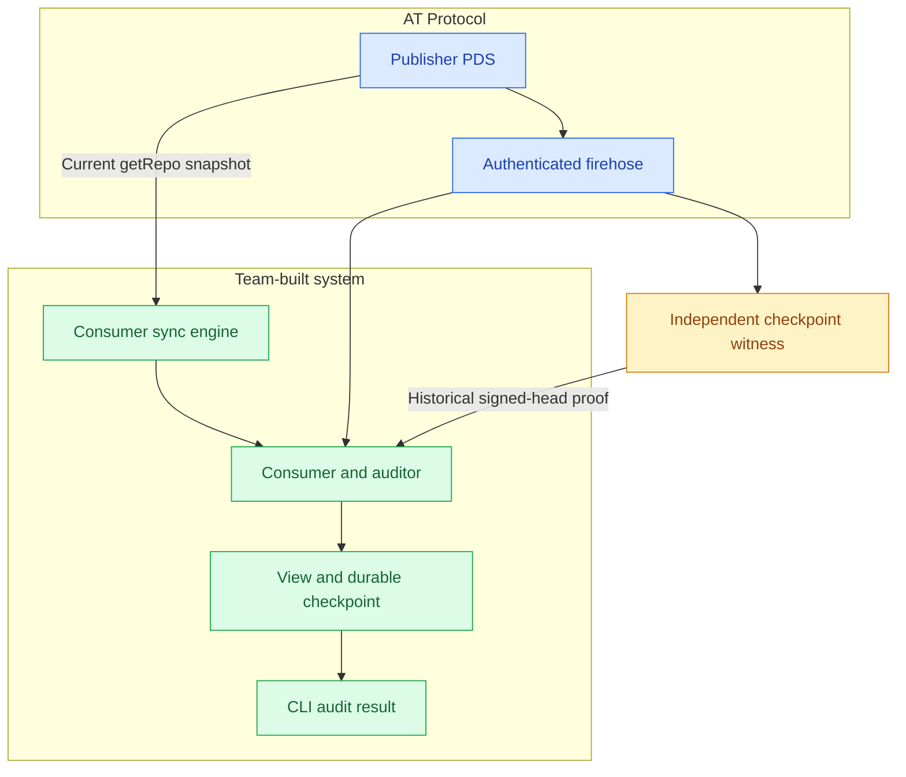
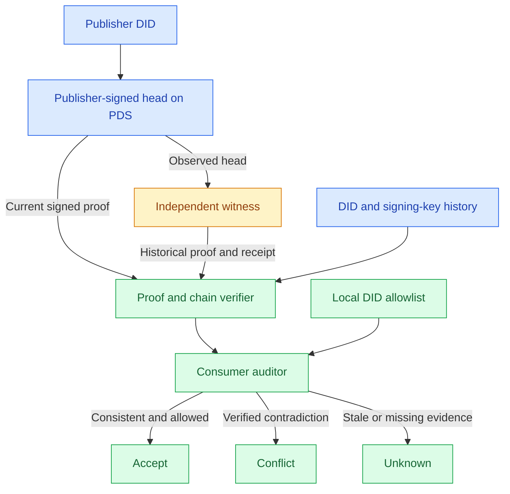

# Federated Event Trust Lab

**CSE 210 · Team 03 (WE BALL)** · **November 6, 2026** · **Working design / three-week core + optional stretch sprint**

## Imagine this

You buy a concert ticket. The organizer publishes a **“ticket issued” event** in its signed AT repository, and an independent witness preserves proof that the event was recorded. Later, the organizer quietly rewrites its records and claims your ticket never existed. The organizer controls its repository, but a consumer can compare the new history against the **earlier witnessed proof** and flag the contradiction.

**That's the idea:** a public, tamper-evident event history whose trust checks don't depend solely on the publisher. We test whether AT adds anything beyond an equivalently witnessed, signed HTTP server.

*This is a motivating scenario, not a ticketing product.* Our demo uses synthetic software-release events; we are **not** verifying payments, ticket ownership, or preventing double-spending.

## Vocabulary

| Term | Plain-English meaning |
| --- | --- |
| **AT Protocol** | Decentralized identity, signed repositories, and a network for distributing changes. |
| **DID** | **Decentralized Identifier**: stable publisher/witness identity (e.g., `did:plc:...`), independent of hosting. |
| **DID document / handle** | The document locates signing keys and the PDS; a handle is a human-readable username, not the stable identity. |
| **PDS / repository** | Personal Data Server hosting an account's signed **current** record collection. The repository is mutable, not an immutable Kafka log. |
| **Lexicon** | AT's schema/interface format; we define our own event and stream-head records. |
| **Firehose** | Live feed of repository changes; useful for discovery, **not durable history by itself**. |
| **CID / CAR / MST** | CID identifies content by hash; CAR transports data blocks; MST enables authenticated record proofs. |
| **Stream head / hash chain** | Our latest sequence/CID record and event-to-previous-event CID links. **These are our additions**, not AT guarantees. |
| **Witness** | An independent observer preserving a publisher-signed historical head and its proof. |
| **Checkpoint / backfill** | Local processed position / reconstruction of retained events after downtime. |
| **Freshness / rollback** | How recently evidence was checked / a contradiction with previously observed signed history. |

## Scope

- **P0 — Three-week commitment:** Publish and authenticate custom records, enforce per-stream order, recover a crashed consumer, and detect one witnessed publisher rewrite. Demo a signed withdrawal, compare against an equivalently witnessed signed server, and test DID-only onboarding.
- **Stretch — Only after P0 passes:** Trust dashboard, witness-freshness instrumentation, broader fault injection, multi-PDS/relay experiment, and one live-network smoke test.
- **Deferred:** Content mirrors, multiple-witness voting, reputation scoring, full PDS migration, partitions, consensus, and production deletion/opt-out policy.
- **Dependencies:** Use crypto, CID/CAR/MST, DID, WebSocket, database, and `@atproto/sync` libraries as needed. **Our team builds** the event contract, cutover/checkpoints, witness, auditor, benchmarks, and UI; we do not adopt an entire existing event system.

**Retention for this PoC:** Synthetic data only. Keep the older witnessed proof through its audit test, then clean up the fixture. Do not implement ongoing hash-retention rules or automatically replace an older proof before checking that a newer head extends it.

## What the product could look like

### P0 by the end of week 3 — a working local CLI/demo

A developer runs one command, watches a publisher's events get witnessed, then sees the consumer recover and **explain a tampered history**. A basic test report accompanies the demo; no polished UI or multi-node deployment is required.

```text
$ trustlab demo --scenario rollback
PUBLISH   releases: events 1 → 2 → 3
WITNESS   saved signed head (seq 3)
FAILURE   consumer stopped; publisher replaced event 2
RECOVER   snapshot loaded; local checkpoint restored
AUDIT     CONFLICT: event 3 references the old event-2 CID
CONTROL   clean reset; signed withdrawal → ACCEPT
```

### Fully fleshed-out vision — future product, **not a three-week promise**

A developer-facing console for **multiple AT publishers and streams**. Consumers pick which DIDs/witnesses they trust, inspect cryptographic evidence, monitor lag and freshness, and recover from permitted mirrors when upstream hosting fails.

```text
FEDERATED EVENT TRUST                         [Inspect proof]
Publisher  did:plc:example...    Stream  releases
Status     CONFLICT              Last checked  15s ago

Publisher head      seq 128   |   consumer checkpoint 125
Trusted witnesses   Alice: verified   Bob: stale   Carol: offline
History audit       seq 126 changed after signed checkpoint

[Compare witness heads] [Replay events] [Export evidence]
```

*Both are illustrative mockups, not implemented screens or measured results.* The full vision could add mirrors and multiple witnesses later, without implying blockchain consensus or guaranteed availability.

## How AT Protocol fits

1. **Write:** A publisher uses a DID-owned PDS to publish a custom Lexicon event and application stream-head record.
2. **Discover and verify:** Our consumer reads `com.atproto.sync.subscribeRepos`, authenticates signed repo commits/record proofs, and follows only allowed publisher/witness DIDs.
3. **Recover:** Our code takes a current `com.atproto.sync.getRepo` snapshot, reconciles buffered live updates, and resumes its local checkpoint.
4. **Audit:** A witness independently captures a **publisher-signed commit, head proof, and its own observation receipt**. Our auditor compares current history against that prior evidence.

**Runtime ownership:** The publisher writes when its application emits an event. The witness subscribes, verifies, and stores a checkpoint on each observed stream-head update; it does **not** publish every checkpoint back onto AT. For P0, consumers request witnessed evidence from our small local HTTP API. On restart, the **consumer sync engine** rebuilds its own view from the PDS; a hash-only witness cannot restore missing publisher content. See [Operational model](docs/operational-model.md) for triggers, calls, and failure behavior.

AT provides verifiable **current** repository state, not a permanent append-only log or a universally trusted witness. The application defines and checks its own historical commitments.

### System architecture



**Without the diagram:** PDS → firehose → consumer → view/CLI result; the consumer also obtains PDS snapshots, while a separate witness supplies prior signed evidence.

### Trust model



**Trust is consumer-chosen.** Publisher and witness signatures authenticate evidence; they do **not** establish honesty or freshness. A bad witness can withhold or replay old evidence, but cannot forge an uncompromised publisher's signature. No global consensus or guaranteed complete history is claimed.

## Implementation contracts

| Contract | Concrete rule / verification |
| --- | --- |
| **Event order** | Sequence is per `(publisher DID, stream)`, starting at 1. For `n > 1`, `prevEventCid` **must** match the CID of `n-1`. Sequence 1 declares genesis. |
| **Atomic publish** | Deterministic keys (e.g., `releases-000000000042`); create event + update stream head together with `com.atproto.repo.applyWrites` and `swapCommit`. Retry conflicts; test lost-response idempotency. |
| **Corrections** | Append signed `correct` or `withdraw` events as **new sequences**. Silent in-place edits/deletes violate our application contract. |
| **Recovery** | Buffer live commits, verify a `getRepo` snapshot, rebuild by sequence, drain newer buffered updates, deduplicate, then atomically save view + checkpoint. Report gaps instead of silently skipping. |
| **Witness proof** | Keep publisher DID, signed commit, CAR/MST proof for the stream head, head CID/sequence, and signed witness receipt. Audit backward to the last witnessed head. |
| **Limits** | A first-time consumer cannot detect pre-observation rewrites. During a PDS outage, current state/deletion status is `unknown`. Historical key rotation needs verifiable key history or an `unresolved` result. |

**Week-1 protocol probe:** `com.atproto.sync.getRecord` describes nonexistence proofs but also a `RecordNotFound` error. Test which behavior our PDS actually returns; do not claim absence proofs without evidence.

## Threat model

Assume **one dishonest publisher** and **one honest witness that previously saved a signed head**. We test contradictions relative to that observation.

| Scenario | Scope | Expected outcome |
| --- | --- | --- |
| Publisher edits an interior event after a witnessed head | **Core demo** | Broken CID chain → `conflict`. |
| Publisher truncates a head or rewrites a suffix | **Test** | Conflict with saved signed checkpoint. |
| Consumer crashes/misses live events | **Core demo** | Rebuild from retained state and resume, or report a gap. |
| Legitimate signed withdrawal | **Control** | `accept`; no false rollback allegation. |
| Stale-but-signed witness / temporary PDS outage | **Stretch** | Known staleness flagged; otherwise `unknown`, not proof of freshness. |
| Rewriting history before **any** honest observation | **Out** | There is no earlier evidence to compare. |
| Colluding witnesses/publisher, stolen keys, global consensus | **Out** | No guarantee. |
| Malicious PDS split view, PDS migration, full mirror failover | **Stretch** | Not needed for the core demo. |

## One end-to-end demo

1. Publish three synthetic software-release events; the witness saves the signed head at sequence 3. The consumer initially accepts the stream.
2. Stop the consumer. Have the controlled publisher **replace event 2 in place** while leaving event 3 and the application head untouched.
3. Restart the consumer. Rebuild via `getRepo`; event 3 still references the **old** event-2 CID. Show the failed comparison and the **`conflict`** verdict in the CLI result.
4. Reset the fixture, append a **valid signed withdrawal** at the next sequence, and show **`accept`**.

**Pass:** Detect the injected edit on repeat runs; do not falsely flag the withdrawal; restore the correct retained view/checkpoint. Record recovery time, proof-check time, missing/duplicate count, and test pass rate.

## Benchmarks: what does AT actually add?

Use identical synthetic events, witness logic, and failure schedules across all four cases:

| | No independent witness | Independent checkpoint witness |
| --- | --- | --- |
| **Signed HTTP server** | **S0** — signed chain; configured HTTPS origin/key | **S1** — S0 plus witness |
| **AT Protocol** | **A0** — signed PDS repo; DID-based discovery | **A1** — A0 plus witness |

- **Integrity:** Detection rate for witnessed rewrites; false conflicts on clean withdrawals.
- **Recovery:** Missing/duplicate events, final-view equality, p95 rebuild time.
- **Overhead:** Verification latency and retained proof bytes.
- **AT-specific P0:** Onboard a consumer from only a DID; compare setup steps, time, and failures against S0's documented URL/key bootstrap.
- **Stretch freshness:** Verify correct `verified_as_of` and `unknown` status after disconnection.

**Honest outcome:** If A1 adds no measurable portability, recovery, or verification benefit over S1 for this workload—or costs materially more—report that. A negative result is still a useful software-engineering finding.

## Three-week delivery plan + optional stretch sprint

| Week | Deliverable | Exit check |
| --- | --- | --- |
| **1 — Prove the protocol path** | Local PDS/PLC, Lexicon publisher, DID allowlist, verified firehose, consumer-kill/`getRepo` rebuild spike, invalid-proof test; probe missing-key `getRecord`. | **Three repeatable runs:** verified publish, crash/restart reconstruction, invalid-proof rejection. If the gate fails, decide immediately whether to use a local PostgreSQL log + AT attestations fallback. |
| **2 — Finish the core failure demo** | Atomic writes and CID links, signed withdrawals, snapshot/live cutover, durable checkpoints, independent witness with proof storage/API, rollback auditor. | Repeat publisher interior-rewrite → `conflict` and valid withdrawal → `accept` three times; clean runs have zero gaps/duplicates. |
| **3 — Measure and ship** | S0/S1 signed-server baseline, A0/A1 comparison, DID-only onboarding test, automated fault tests, reproducible CLI demo, limitations and brief ADRs/retro. | Publish 2×2 result table (correctness, recovery time, proof overhead), pass one repeatable demo, and explain what AT adds or fails to add. |
| **Stretch sprint (optional)** | Minimal dashboard, freshness UI/status, additional tampering and outage tests, multi-PDS/relay federation experiment, live-network smoke test. | Only begin after week-3 core and evidence are stable; explicitly report what was and wasn't tested. |

**Test environment:** All core services run locally. Use a controlled PDS/PLC fixture for crashes and tampering; a local PDS **without a relay does not prove federation**. A live-network smoke test is optional stretch, not a gate. Use standard libraries where helpful; don't copy another application's event system.

**Engineering practice:** Track user stories/issues, review PRs, run CI, and write ADRs for architectural tradeoffs—not routine imports.

## Technology stack and why

These are **working defaults**, not a requirement to reinvent standard infrastructure. The Week-1 spike can change a package if it does not expose the proof data we need.

| Technology | Purpose / reason |
| --- | --- |
| **TypeScript + Node.js** | One typed language for publisher, consumer, witness, CLI, and the signed-server baseline; strong AT library support. |
| **Local AT PDS + PLC** (e.g., `@atproto/dev-env`) | Real AT repositories/DIDs under our control; repeatable outages and tampering without touching hosted accounts. |
| **`@atproto/sync` + `@atproto/crypto` / repo utilities** | Authenticate firehose commits, signatures, and CAR/MST proofs using established protocol libraries. We still write our own history auditor and recovery logic. |
| **SQLite** | Simple local persistence for consumer checkpoints/views and the signed HTTP baseline; transactional crash tests without running a database cluster. |
| **Node CLI + small HTTP API** | The P0 terminal demo, witness checkpoint lookup, and a narrow interface for benchmarks/inspection; minimal deployment overhead. |
| **React + Vite (stretch)** | Lightweight trust dashboard using the same TypeScript data contracts; defer UI work until the core demo passes. |
| **Vitest + scripted fault-injection/benchmark harness** | Deterministic publisher edits, consumer crashes, repeat runs, and exported timing/correctness results. |
| **Docker Compose + GitHub Actions** | Run team-owned services locally and check tests/builds on every PR. **No AWS/CDK or Kafka cluster.** |

## Protocol references

- [DIDs and identity](https://atproto.com/specs/did) · [Account hosting and migration](https://atproto.com/specs/account)
- [Repository signatures, proofs, and deletion](https://atproto.com/specs/repository) · [Sync](https://atproto.com/specs/sync)
- [`applyWrites` and `swapCommit`](https://github.com/bluesky-social/atproto/blob/main/lexicons/com/atproto/repo/applyWrites.json) · [`getRecord` proof/error contract](https://github.com/bluesky-social/atproto/blob/main/lexicons/com/atproto/sync/getRecord.json)
- [`@atproto/sync`](https://github.com/bluesky-social/atproto/tree/main/packages/sync) is an eligible library; [Tap](https://atproto.com/blog/introducing-tap) and Ramjet are prior art, not adopted event systems.
